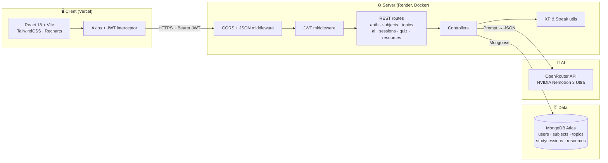
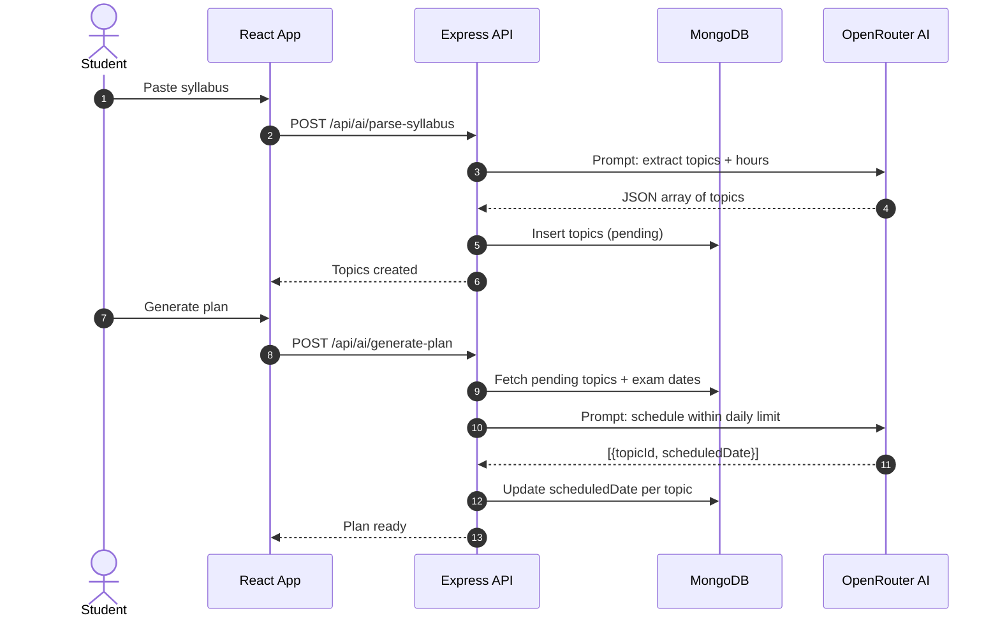
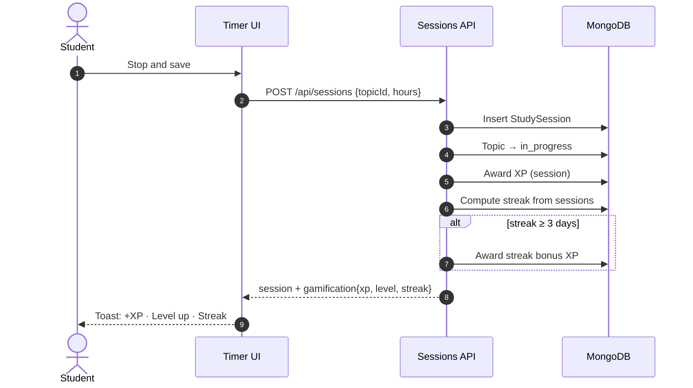
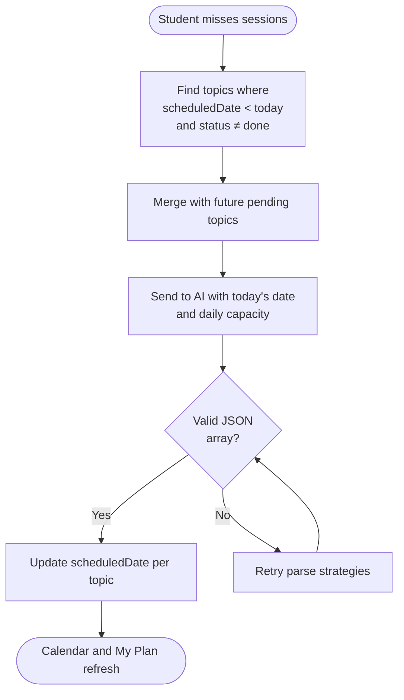
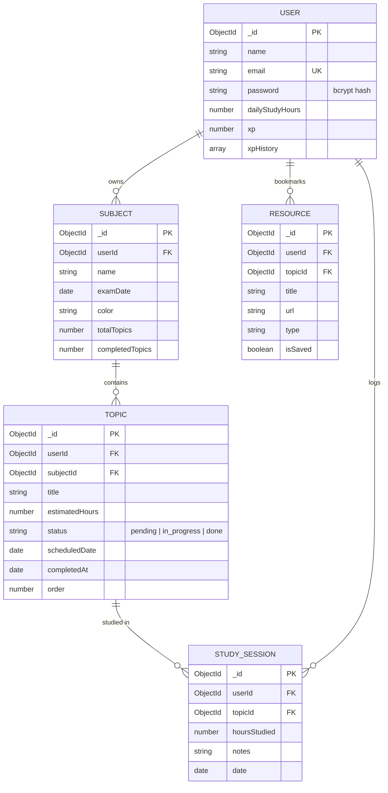
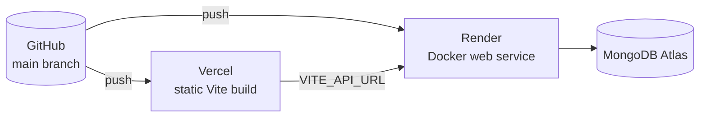

<div align="center">


<br/>


<br/><br/>

<a href="https://plantree.vercel.app"></a>
&nbsp;
<a href="#-getting-started"></a>
&nbsp;
<a href="#-api-reference"></a>

</div>

---

## 📑 Table of Contents

- [Overview](#-overview)
- [Features](#-features)
- [Architecture](#-architecture)
- [Data Flow](#-data-flow)
- [AI Pipeline](#-ai-pipeline)
- [Gamification (XP & Streak)](#-gamification-xp--streak)
- [Tech Stack](#-tech-stack)
- [Database Schema](#-database-schema)
- [API Reference](#-api-reference)
- [Project Structure](#-project-structure)
- [Getting Started](#-getting-started)
- [Environment Variables](#-environment-variables)
- [Deployment](#-deployment)
- [Testing](#-testing)
- [Security](#-security)
- [Roadmap](#-roadmap)
- [Contributing](#-contributing)
- [License](#-license)

---

## 🌱 Overview

**Plantree** is a full-stack AI study planner. It turns a raw syllabus into a
day-by-day study schedule, tracks progress, replans when sessions are missed,
and keeps students motivated with XP, levels and streaks.

| Problem | Plantree's answer |
|---|---|
| Manual timetables take hours | AI parses the syllabus and estimates hours per topic |
| Missed days break the plan | Adaptive replanning reschedules remaining topics |
| No idea how much was studied | Timed sessions and a GitHub-style activity heatmap |
| Hard to know if you're ready | Analytics, quizzes unlocked at 100% completion |
| Scattered learning material | AI-suggested resources, bookmarked per topic |

---

## ✨ Features

<table>
<tr>
<td width="50%">

### 🧠 AI Planning
- Syllabus parsing from text or PDF
- Day-by-day plan with daily-hour limits
- Adaptive replanning for missed topics

### ⏱️ Study Tracking
- Timer with SVG progress ring
- Sessions grouped by topic
- Activity heatmap (365 days)

</td>
<td width="50%">

### 🎯 Assessment and Growth
- AI MCQ quiz per completed subject
- XP, levels and streak bonuses
- Analytics and exam countdown

### 📚 Resources
- AI-suggested learning links
- Bookmark per topic, search and filter

</td>
</tr>
</table>

---

## 🏗️ Architecture



### Layer responsibilities

| Layer | Responsibility |
|---|---|
| **Client** | Rendering, routing, optimistic UI, toast notifications |
| **Middleware** | CORS allow-list, body parsing, JWT verification |
| **Routes / Controllers** | Input validation, business logic, response shaping |
| **Utilities** | XP awarding, level calculation, streak computation |
| **Data** | Persistent storage, per-user isolation via `userId` |
| **AI** | Stateless prompt in, structured JSON out |

---

## 🔄 Data Flow

### 1. Plan generation



### 2. Study session and gamification



### 3. Adaptive replanning



---

## 🤖 AI Pipeline

| Task | Input | Output | Endpoint |
|---|---|---|---|
| Syllabus parsing | Raw text or PDF | Topics + estimated hours | `POST /api/ai/parse-syllabus` |
| Plan generation | Pending topics, exam dates, daily hours | `topicId` → `scheduledDate` | `POST /api/ai/generate-plan` |
| Replanning | Missed + future topics | Fresh schedule from today | `POST /api/ai/replan` |
| Quiz | Topic titles of a subject | 10 MCQs with answers | `POST /api/quiz/generate` |
| Resources | Topic and subject name | 6 links (video, article, docs, book) | `POST /api/resources/suggest` |

### Reliability of AI output

Language models sometimes add prose or markdown around JSON, so every response
goes through three parse strategies:

```
1. JSON.parse(raw)                      → success? done
2. Regex: first [ ... ] block → parse   → success? done
3. Strip ```json fences → parse         → success? done
4. Return 500 with a user-facing message
```

---

## 🏆 Gamification (XP & Streak)

```
Topic completed     → +20 XP
Study session       → +5 XP per 30 min (minimum 5)
Quiz completed      → +10 XP + (score × 2)
3+ day streak       → +10 XP streak bonus

Level  = floor(sqrt(XP / 100)) + 1
Streak = consecutive days with at least one session (IST)
```

| Level | XP needed |
|---|---|
| 1 → 2 | 100 |
| 2 → 3 | 400 |
| 3 → 4 | 900 |
| 4 → 5 | 1600 |

---

## 🧰 Tech Stack

| Layer | Technology | Why |
|---|---|---|
| Frontend | React 18, Vite | Fast dev loop, component model |
| Styling | TailwindCSS v3 | Consistent design tokens |
| Charts | Recharts | Declarative, React-native charts |
| Routing | React Router v6 | Protected routes |
| HTTP | Axios | Interceptors for JWT and 401 handling |
| Backend | Node.js 20, Express | Lightweight REST API |
| Database | MongoDB Atlas, Mongoose | Flexible documents, schema validation |
| Auth | JWT, bcryptjs | Stateless auth, salted password hashes |
| AI | OpenRouter (NVIDIA Nemotron 3 Ultra) | Free tier, OpenAI-compatible SDK |
| Uploads | Multer, pdf-parse | PDF syllabus extraction |
| Containers | Docker, Docker Compose | Reproducible local environment |
| Hosting | Render (API), Vercel (SPA) | Free tiers, auto-deploy from `main` |

---

## 🗄️ Database Schema



Every document carries a `userId`, and every query filters by the
authenticated user, so one student can never read another's data.

---

## 📡 API Reference

Base URL: `https://<your-backend>.onrender.com` · Protected routes need
`Authorization: Bearer <token>`.

| Group | Method | Endpoint | Auth |
|---|---|---|---|
| Auth | `POST` | `/api/auth/register` | ❌ |
| Auth | `POST` | `/api/auth/login` | ❌ |
| Auth | `GET` / `PATCH` | `/api/auth/me` | ✅ |
| Subjects | `POST` / `GET` | `/api/subjects` | ✅ |
| Subjects | `PATCH` / `DELETE` | `/api/subjects/:id` | ✅ |
| Topics | `POST` | `/api/topics` | ✅ |
| Topics | `GET` | `/api/topics/:subjectId` | ✅ |
| Topics | `GET` | `/api/topics/today` | ✅ |
| Topics | `PATCH` | `/api/topics/:id/status` | ✅ |
| AI | `POST` | `/api/ai/parse-syllabus` | ✅ |
| AI | `POST` | `/api/ai/generate-plan` | ✅ |
| AI | `POST` | `/api/ai/replan` | ✅ |
| AI | `GET` | `/api/ai/dashboard` | ✅ |
| Sessions | `POST` / `GET` | `/api/sessions` | ✅ |
| Sessions | `GET` | `/api/sessions/activity` | ✅ |
| Sessions | `GET` | `/api/sessions/streak` | ✅ |
| Quiz | `POST` | `/api/quiz/generate` | ✅ |
| Quiz | `POST` | `/api/quiz/complete` | ✅ |
| Resources | `POST` | `/api/resources/suggest` | ✅ |
| Resources | `POST` | `/api/resources/save` | ✅ |
| Resources | `GET` | `/api/resources` | ✅ |
| Resources | `DELETE` | `/api/resources/:id` | ✅ |

### Sample: save a study session

```bash
curl -X POST https://<backend>/api/sessions \
  -H "Authorization: Bearer <token>" \
  -H "Content-Type: application/json" \
  -d '{"topicId":"665f...","hoursStudied":1.5,"notes":"Recursion basics"}'
```

```json
{
  "success": true,
  "data": { "_id": "...", "hoursStudied": 1.5 },
  "gamification": {
    "xp": { "xp": 180, "level": 2, "leveledUp": true, "gained": 15 },
    "streak": 4,
    "streakBonus": { "gained": 10 }
  }
}
```

---

## 📁 Project Structure

```
plantree-ai-study-planer/
├── backend/
│   ├── src/
│   │   ├── config/        # db.js, ai.js (OpenRouter client)
│   │   ├── controllers/   # ai, resource, topic, subject, auth
│   │   ├── middleware/    # auth.middleware.js (JWT)
│   │   ├── models/        # User, Subject, Topic, StudySession, Resource
│   │   ├── routes/        # one router per feature
│   │   └── utils/         # xp.js, streak.js
│   ├── Dockerfile
│   ├── server.js
│   └── package.json
├── frontend/
│   ├── src/
│   │   ├── components/    # layout, dashboard, cards, common
│   │   ├── context/       # AuthContext
│   │   ├── hooks/         # useDashboard
│   │   ├── pages/         # Dashboard, MyPlan, Subjects, Quiz, ...
│   │   ├── services/      # api.js (Axios instance)
│   │   └── utils/         # gamification.js, xpNotify.js
│   ├── Dockerfile
│   ├── nginx.conf
│   ├── vercel.json
│   └── vite.config.js
├── docker-compose.yml
└── README.md
```

---

## 🚀 Getting Started

### Option A: Docker Compose (recommended)

```bash
git clone https://github.com/smzaid0062/plantree-Ai-study-planer.git
cd plantree-Ai-study-planer

cp backend/.env.example backend/.env.local   # fill in values
docker compose up --build
```

| Service | URL |
|---|---|
| Frontend | http://localhost:5173 |
| Backend | http://localhost:5000 |
| MongoDB | mongodb://localhost:27017 |

### Option B: Run manually

```bash
# Backend
cd backend
npm install
cp .env.example .env
npm run dev

# Frontend (new terminal)
cd frontend
npm install
echo "VITE_API_URL=" > .env.local    # empty: Vite proxy handles /api
npm run dev
```

---

## 🔐 Environment Variables

### Backend (`backend/.env`)

| Variable | Example | Required |
|---|---|---|
| `PORT` | `5000` | ✅ |
| `MONGO_USERNAME` | `atlas_user` | ✅ (Atlas) |
| `MONGO_PASSWORD` | `••••••` | ✅ (Atlas) |
| `MONGO_CLUSTER` | `cluster0.xxxxx.mongodb.net` | ✅ (Atlas) |
| `MONGO_DB_NAME` | `plantree` | ✅ |
| `MONGO_APP_NAME` | `Cluster0` | ✅ |
| `JWT_SECRET` | `long-random-string` | ✅ |
| `OPENROUTER_API_KEY` | `sk-or-...` | ✅ |
| `CLIENT_URL` | `https://plantree.vercel.app` | ✅ (CORS) |

### Frontend (`frontend/.env`)

| Variable | Local | Production |
|---|---|---|
| `VITE_API_URL` | *(empty, uses proxy)* | `https://<backend>.onrender.com` |

> ⚠️ Never commit `.env` files. Use the platform's environment settings in
> production.

---

## 🌍 Deployment



1. **Backend (Render):** New Web Service → root `backend` → Environment: Docker
   → add the variables above.
2. **Frontend (Vercel):** Import repo → root `frontend` → framework Vite →
   set `VITE_API_URL` to the Render URL. `vercel.json` handles SPA routing.
3. **Atlas:** Network Access → allow the Render egress IPs, or `0.0.0.0/0`
   for a demo project.
4. **CORS:** set `CLIENT_URL` on Render to the exact Vercel origin, with no
   trailing slash.

---

## 🧪 Testing

```bash
# Manual API checks (Postman collection in /docs)
# 1. Register → login → copy token
# 2. Create subject → parse syllabus → generate plan
# 3. Save session → verify gamification in response
# 4. Complete topic → verify XP and toast
```

| Area | Status |
|---|---|
| Auth (register, login, 401 handling) | ✅ Verified |
| Subjects and topics | ✅ Verified |
| AI parse, plan, replan | ✅ Verified |
| Sessions, heatmap, XP, streak | ✅ Verified |
| Quiz generation | ✅ Verified |
| Resources (UI) | 🔄 In progress |
| Docker Compose end-to-end | 🔄 In progress |

Automated tests (Jest + Supertest) are planned; see the roadmap.

---

## 🛡️ Security

- **Passwords:** bcrypt hashed with cost factor 12, never returned in responses
- **Auth:** JWT (7-day expiry) in `Authorization` header
- **Isolation:** every query filtered by the authenticated `userId`
- **CORS:** allow-list from `CLIENT_URL`, not `*`
- **Secrets:** environment variables only; `.env` files git-ignored
- **Input:** required fields validated before database writes
- **Errors:** generic messages to clients, details only in server logs

---

## 🗺️ Roadmap

- [x] AI syllabus parsing and planning
- [x] Adaptive replanning
- [x] Timed sessions and heatmap
- [x] XP, levels and streaks
- [x] AI quizzes and resources
- [ ] Spaced-repetition revision (SM-2)
- [ ] PDF notes chat (RAG)
- [ ] Automated test suite and CI pipeline
- [ ] Email and push reminders
- [ ] Shared study groups

---

## 🤝 Contributing

```bash
git checkout -b feature/your-feature
git commit -m "feat: describe the change"
git push -u origin feature/your-feature
```

Open a Pull Request against `main`. Keep commits small and follow the
conventional prefixes: `feat`, `fix`, `chore`, `docs`, `refactor`.

---

## 👨‍💻 Author

**Md Zaid**
MCA, Chandigarh University · Cloud Computing and DevOps
GitHub: [@smzaid0062](https://github.com/smzaid0062)

---

## 📄 License

Released under the [MIT License](LICENSE).

<div align="center">

### ⭐ If Plantree helped you study smarter, consider starring the repo.


</div>
